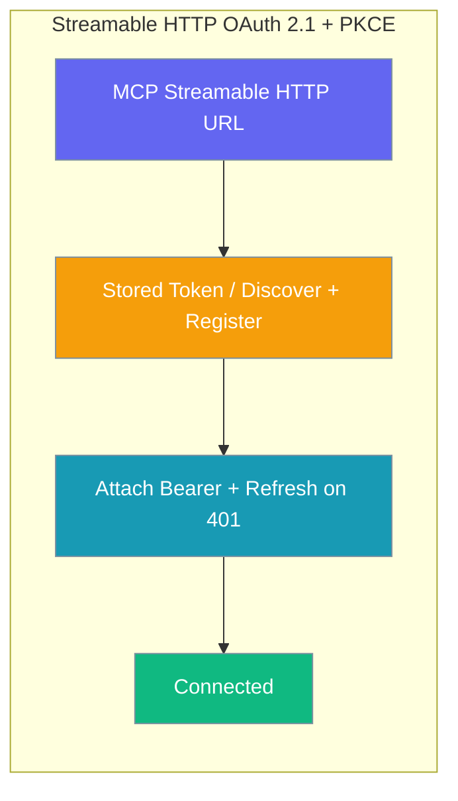
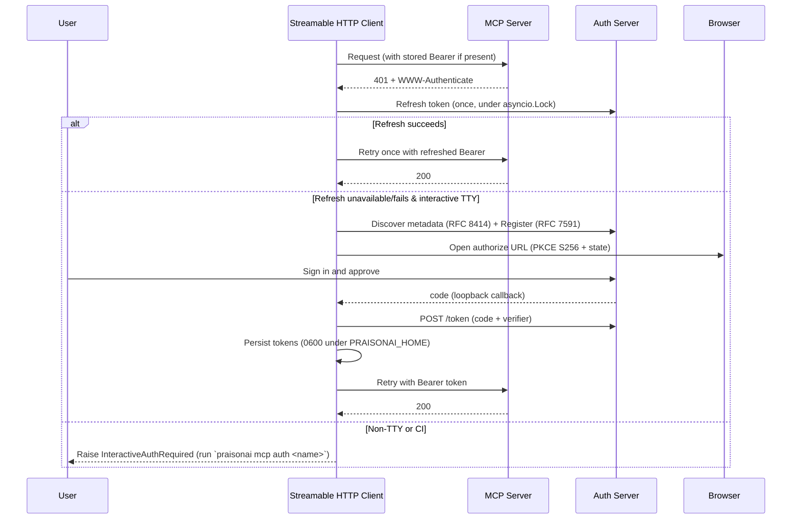

Connect agents to OAuth-protected remote MCP servers over **Streamable HTTP** — sign in once via the CLI or an interactive TTY, and PraisonAI attaches stored Bearer tokens and refreshes them automatically on HTTP `401`.

<Note>
**Transport scope:** Automatic Bearer token attachment, `401` refresh-and-retry, and interactive TTY sign-in apply to **Streamable HTTP** transports (`HTTPStreamMCPClient`, `MCP(..., oauth=True, server_name=...)`, and `MCP.from_config({"url": ..., "oauth": True}, name=...)`). Legacy `/sse` and WebSocket transports do not auto-attach OAuth tokens yet — passing `oauth=True` with a legacy `/sse` URL logs a warning and skips OAuth.
</Note>

<Note>
This page covers PraisonAI acting as an **OAuth client** connecting to external MCP servers. To host a PraisonAI MCP server with built-in OAuth 2.1 sign-in for Cursor, VS Code, Claude Code, and other editors, see [MCP Server OAuth 2.1](/features/mcp-server-oauth).
</Note>



## Supported Capabilities

| Capability | Status |
|---|---|
| OAuth 2.1 utilities (PKCE `S256`, `state`, loopback callback) | ✅ |
| Token storage (`$PRAISONAI_HOME/mcp-auth.json`, mode `0600`) | ✅ |
| Metadata discovery (RFC 8414 + OpenID fallback) | ✅ |
| Dynamic Client Registration (RFC 7591, no `client_id` required when supported) | ✅ |
| `praisonai mcp auth <name>` interactive CLI sign-in | ✅ |
| Streamable HTTP automatic Bearer attachment (`MCP` / `MCP.from_config` / `HTTPStreamMCPClient`) | ✅ |
| Serialized single-attempt refresh + retry on HTTP `401` | ✅ |
| Headless / CI fail-closed signal (`InteractiveAuthRequired`, never opens a browser in CI) | ✅ |
| Explicit `Authorization` header precedence (never overridden by OAuth) | ✅ |
| Legacy `/sse` and WebSocket auto-attachment | Not yet supported |

## Quick Start

<Steps>
  <Step title="Enable OAuth on a Streamable HTTP MCP client">
    Pass `oauth=True` and `server_name` to `MCP(...)` (or use `MCP.from_config`):

    ```python
    from praisonaiagents import Agent, MCP

    agent = Agent(
        instructions="You help with GitHub tasks",
        tools=MCP(
            "https://api.githubcopilot.com/mcp/",
            oauth=True,
            server_name="github",
        ),
    )

    agent.start("List my open pull requests")
    ```

    Or build from a config dict:

    ```python
    from praisonaiagents import Agent, MCP

    mcp = MCP.from_config(
        {"url": "https://api.githubcopilot.com/mcp/", "oauth": True},
        name="github",
    )
    agent = Agent(instructions="You help with GitHub tasks", tools=mcp)
    agent.start("List my open pull requests")
    ```

    In an interactive terminal (TTY, outside CI), an initial `401` triggers discovery, registration, and browser sign-in once. Tokens are cached under `$PRAISONAI_HOME/mcp-auth.json` (default `~/.praisonai/mcp-auth.json`, mode `0600`).
  </Step>
  <Step title="Pre-seed tokens from the CLI (recommended for CI / headless)">
    ```bash
    # One-time interactive OAuth 2.1 + PKCE sign-in
    praisonai mcp auth github
    ```

    Once tokens are cached for a server URL, Streamable HTTP clients automatically attach `Authorization: Bearer <token>` on subsequent runs and refresh expired tokens on `401`.
  </Step>
</Steps>

## How Streamable HTTP OAuth Works

When a Streamable HTTP client has `oauth` enabled (or finds a stored token for the server URL) and no explicit `Authorization` header was supplied:

1. **Attach Bearer token** — reads a valid token from `$PRAISONAI_HOME/mcp-auth.json` and sends `Authorization: Bearer <token>`. Explicit `Authorization` headers always take precedence and are never overwritten.
2. **Refresh once on HTTP `401`** — if the server responds `401`, the client attempts a refresh-token grant **once** (serialized with an `asyncio.Lock` so concurrent requests do not race) and retries the request once with the new token.
3. **Interactive TTY vs CI / headless** — if refresh is unavailable or fails:
   - **Interactive TTY (non-CI):** runs the OAuth 2.1 + PKCE browser flow (discovery via `WWW-Authenticate` / RFC 8414, optional RFC 7591 client registration, loopback callback, token exchange) and retries with the new token.
   - **Non-TTY or CI (`CI` / `GITHUB_ACTIONS` set):** never opens a browser; raises `InteractiveAuthRequired` with the exact command to run (`praisonai mcp auth <name>`).



## Interactive vs Headless / CI

<Tabs>
  <Tab title="Streamable HTTP via MCP (recommended)">
    ```python
    from praisonaiagents import MCP
    from praisonaiagents.mcp import InteractiveAuthRequired

    try:
        mcp = MCP(
            "https://api.example.com/mcp",
            oauth=True,
            server_name="linear",
        )
    except InteractiveAuthRequired as exc:
        # In non-TTY or CI, never opens a browser; message names `praisonai mcp auth linear`
        print(exc)
    ```
  </Tab>
  <Tab title="Direct MCPOAuthProvider">
    ```python
    from praisonaiagents.mcp import MCPOAuthProvider, InteractiveAuthRequired

    provider = MCPOAuthProvider(
        mcp_name="github",
        server_url="https://api.githubcopilot.com/mcp/",
        open_browser=False,  # set True for interactive terminal flows
    )

    try:
        token = provider.ensure_authenticated()
    except InteractiveAuthRequired:
        print("Run `praisonai mcp auth github` interactively first.")
    ```
  </Tab>
</Tabs>

<Tip>
For CI, run `praisonai mcp auth <name>` once interactively on a workstation to seed `$PRAISONAI_HOME/mcp-auth.json`, then mount or copy that file (keeping mode `0600`) into the CI runner. In non-TTY or CI environments (`CI` or `GITHUB_ACTIONS` set), Streamable HTTP clients never open a browser and raise `InteractiveAuthRequired` naming `praisonai mcp auth <name>`.
</Tip>

## Configuration Schema

### Streamable HTTP with OAuth

In `MCP.from_config(...)` or your MCP configuration:

```yaml
mcp:
  servers:
    github:
      type: remote
      url: https://api.githubcopilot.com/mcp/
      oauth: true
```

For servers without dynamic client registration (RFC 7591), pass explicit OAuth client fields:

```yaml
mcp:
  servers:
    my-server:
      type: remote
      url: https://mcp.example.com/mcp
      enabled: true
      timeout: 30000  # milliseconds
      oauth:
        client_id: your_client_id
        client_secret: your_client_secret  # optional
        scopes:
          - read
          - write
```

### Remote Server with Explicit `Authorization` Header

When an explicit `Authorization` header is configured, it always takes precedence over OAuth:

```yaml
mcp:
  servers:
    tavily:
      type: remote
      url: https://mcp.tavily.com/mcp
      headers:
        Authorization: Bearer ${TAVILY_API_KEY}
```

## Python SDK

All OAuth helpers are lazy-loaded from `praisonaiagents.mcp`.

### `MCP` and `MCP.from_config`

```python
from praisonaiagents import MCP

# Direct Streamable HTTP client with OAuth
client = MCP(
    "https://api.example.com/mcp",
    oauth=True,
    server_name="linear",
)

# Config-dict builder
client_from_cfg = MCP.from_config(
    {"url": "https://api.example.com/mcp", "oauth": True},
    name="linear",
)
```

| Parameter | Type | Default | Description |
|---|---|---|---|
| `oauth` | `bool \| dict \| None` | `None` | `True` enables zero-config OAuth on Streamable HTTP; a dict supplies explicit `client_id`/`client_secret`/`scopes`; `False` disables OAuth even if a stored token exists. |
| `server_name` | `str \| None` | `None` | Stable storage key matching `praisonai mcp auth <name>`. |

### `HTTPStreamMCPClient`

`MCP` forwards `oauth` and `server_name` (as `transport_options={"oauth": ..., "name": ...}`) to `HTTPStreamMCPClient`, which wires an `httpx.Auth` handler for Bearer attachment and `401` refresh.

```python
from praisonaiagents.mcp.mcp_http_stream import HTTPStreamMCPClient

client = HTTPStreamMCPClient(
    server_url="https://api.example.com/mcp",
    transport_options={"oauth": True, "name": "linear"},
)
```

### `MCPOAuthProvider`

Orchestrates discovery, registration, the PKCE flow, and token refresh for one server:

```python
from praisonaiagents.mcp import MCPOAuthProvider

provider = MCPOAuthProvider(
    mcp_name="github",
    server_url="https://api.githubcopilot.com/mcp/",
)
token = provider.ensure_authenticated()  # opens a browser when open_browser=True
```

| Parameter | Type | Default | Description |
|---|---|---|---|
| `mcp_name` | `str` | — | Stable identifier used as the storage key. |
| `server_url` | `str` | — | The MCP server URL. |
| `storage` | `Any` | `None` | Optional pre-built `MCPAuthStorage` (created lazily otherwise). |
| `open_browser` | `bool` | `True` | Set `False` for headless/CI to raise `InteractiveAuthRequired`. |

| Method | Signature | Returns |
|---|---|---|
| `get_valid_token` | `get_valid_token()` | `str \| None` — a non-expired token, refreshing if possible. |
| `ensure_authenticated` | `ensure_authenticated(www_authenticate=None, timeout=10.0)` | `str` — a valid Bearer token, running the full flow if needed. |

### Discovery and Registration Helpers

```python
from praisonaiagents.mcp import (
    discover_oauth_metadata,
    parse_www_authenticate,
    register_client,
)

challenge = parse_www_authenticate(
    'Bearer resource_metadata="https://auth.example.com/.well-known/oauth-protected-resource"'
)
metadata = discover_oauth_metadata("https://api.githubcopilot.com/mcp/")
```

| Function | Signature | Returns |
|---|---|---|
| `discover_oauth_metadata` | `discover_oauth_metadata(server_url, www_authenticate=None, timeout=10.0)` | `dict \| None` |
| `parse_www_authenticate` | `parse_www_authenticate(header)` | `dict` — `resource_metadata`, `scope`, `error`, etc. |
| `register_client` | `register_client(registration_endpoint, redirect_uris, client_name="PraisonAI Agent", scope=None, timeout=10.0)` | `dict` — at least `{"client_id": ...}` (RFC 7591). |

### `InteractiveAuthRequired`

Raised when interactive OAuth is required in a non-TTY/CI environment or when `open_browser=False`.

```python
from praisonaiagents.mcp import InteractiveAuthRequired
```

### Auth Storage & PKCE Utilities

```python
from praisonaiagents.mcp import (
    MCPAuthStorage,
    get_default_auth_filepath,
    generate_state,
    generate_code_verifier,
    generate_code_challenge,
    get_redirect_url,
    OAuthCallbackHandler,
)

print("Auth file:", get_default_auth_filepath())  # $PRAISONAI_HOME/mcp-auth.json

storage = MCPAuthStorage()
entry = storage.get("github")
if entry and entry.get("tokens") and not storage.is_token_expired("github"):
    print("Authenticated!")

state = generate_state()
verifier = generate_code_verifier()
challenge = generate_code_challenge(verifier)
redirect_url = get_redirect_url()  # http://127.0.0.1:19876/mcp/oauth/callback
```

## CLI Commands

### Authenticate

```bash
praisonai mcp auth <name> [--timeout 300]
```

Runs the interactive OAuth 2.1 + PKCE authorization-code flow and exchanges the returned code for tokens at the discovered `token_endpoint`:

- Opens your browser and waits on the loopback callback (`-t` / `--timeout`, default `300.0`s).
- Persists `access_token`, optional `refresh_token`, and `expires_at` under `$PRAISONAI_HOME/mcp-auth.json` (mode `0600`).
- Automatically clears any legacy placeholder entry from older releases before starting.
- Reads explicit `oauth.client_id` / `client_secret` from config when the server does not support dynamic client registration.
- Exits `1` on failure.

### Logout

```bash
praisonai mcp logout <name> [--yes]
```

Removes stored OAuth tokens and client metadata for `<name>`. Pass `-y` / `--yes` to skip confirmation.

### List Servers

```bash
praisonai mcp list
```

Lists configured MCP servers with their type and status.

## Token Storage

Tokens are persisted to `$PRAISONAI_HOME/mcp-auth.json` (defaulting to `~/.praisonai/mcp-auth.json`) with `0600` owner-only permissions. Tokens are never logged or embedded in URLs.

```json
{
  "github": {
    "server_url": "https://api.githubcopilot.com/mcp/",
    "tokens": {
      "access_token": "gho_xxx...",
      "refresh_token": "ghr_xxx...",
      "expires_at": 1234567890,
      "token_endpoint": "https://auth.example.com/token",
      "scope": "repo user"
    },
    "client_info": {
      "client_id": "xxx"
    }
  }
}
```

## Security

- **HTTPS-only** — metadata, authorize, token, and registration URLs must use HTTPS (loopback `http://127.0.0.1`, `localhost`, `::1` allowed for local testing).
- **Internal-host guard** — non-loopback OAuth endpoints are checked against the SDK's SSRF guard (`is_safe_http_url`), refusing private, link-local, and cloud-metadata addresses before sending requests.
- **Pre-request redirect validation** — discovery validates each redirect hop before following it (max 3 hops).
- **No redirects on credential POSTs** — code-exchange, refresh-token, and registration POSTs never follow redirects so tokens and client secrets are never forwarded to another host.
- **PKCE (`S256`) + random `state`** — enforced on all authorization flows.
- **Owner-only storage (`0600`)** — stored under `PRAISONAI_HOME`, never logged or placed in query strings.

## Troubleshooting

| Issue | Cause / fix |
|---|---|
| `InteractiveAuthRequired` | Running in a non-TTY or CI environment without a valid/refreshable token. Run `praisonai mcp auth <name>` from an interactive terminal and seed `$PRAISONAI_HOME/mcp-auth.json`. |
| OAuth warning on `/sse` URL | OAuth auto-attachment currently applies to Streamable HTTP only, not legacy `/sse` or WebSocket transports. Switch to the server's Streamable HTTP endpoint or pass an explicit `Authorization` header. |
| `RuntimeError: Could not discover OAuth metadata for ...` | Server does not expose RFC 8414 / OpenID metadata. Supply explicit `oauth.client_id` and `oauth.scopes` in config. |
| `RuntimeError: ... does not support dynamic client registration` | No `registration_endpoint` in auth-server metadata. Register a client manually and supply `oauth.client_id`. |
| `ValueError: Refusing OAuth request over insecure transport: ...` | Auth server advertises `http://` endpoints. Use HTTPS. |
| `ValueError: Refusing OAuth request to a private/internal address: ...` | Auth server advertises a private/link-local/metadata host. Refused by design. |
| `ValueError: Too many redirects fetching OAuth metadata: ...` | Discovery exceeded 3 redirect hops. |

## Related

<CardGroup cols={2}>
  <Card title="Remote MCP" icon="globe" href="/mcp/mcp-remote">
    Connect to remote MCP servers via Streamable HTTP, SSE, or WebSocket.
  </Card>
  <Card title="MCP Authentication" icon="shield-check" href="/mcp/mcp-auth">
    Server-side OAuth 2.1, OIDC, and API-key auth for `praisonai-mcp`.
  </Card>
  <Card title="MCP Tools" icon="wrench" href="/mcp/mcp-tools">
    Using MCP tools with agents.
  </Card>
  <Card title="MCP Server" icon="plug" href="/mcp/mcp-server">
    Deploy PraisonAI as an MCP server.
  </Card>
</CardGroup>
