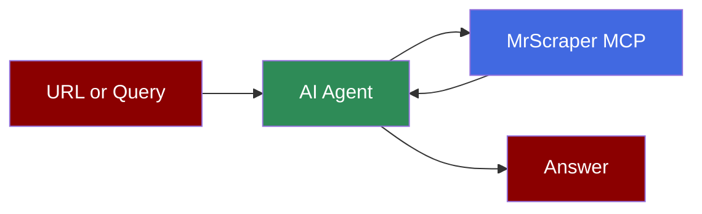

## Add Web Scraping to AI Agent



## Quick Start

<Steps>
    <Step title="Install Dependencies">
        Install PraisonAI with MCP support:
        ```bash
        pip install -U "praisonaiagents[mcp]>=1.7.12"
        ```
        `praisonaiagents` 1.7.12 and later load MrScraper's tools over Streamable HTTP and install a compatible `mcp` 1.x.
    </Step>
    <Step title="Set API Keys">
        Create a MrScraper API key at [app.mrscraper.com/api-tokens](https://app.mrscraper.com/api-tokens) and set it with your model's API key:
        ```bash
        export MRSCRAPER_API_KEY=your_mrscraper_api_key_here
        export OPENAI_API_KEY=your_openai_api_key_here
        ```
    </Step>
    <Step title="Create a file">
        Create a new file `mrscraper_agent.py` with the following code:
        ```python
        from praisonaiagents import Agent, MCP
        import os

        mrscraper_tools = MCP(
            "https://mcp.mrscraper.com/mcp",
            headers={"Authorization": f"Bearer {os.environ['MRSCRAPER_API_KEY']}"},
        )

        scraper_agent = Agent(
            instructions="""You research web pages with MrScraper.
            For a known URL, call scrapeMarkdown and work from the page it
            returns; call scrapeHtml when you need the raw HTML. Call
            webSearch with a query when no URL is known, and status to check
            remaining tokens.""",
            model="gpt-4o-mini",
            tools=mrscraper_tools,
        )

        scraper_agent.start("Fetch https://www.scrapethissite.com and summarize the page.")
        ```
    </Step>
    <Step title="Run the Agent">
        Execute your script:
        ```bash
        python mrscraper_agent.py
        ```
    </Step>
</Steps>

## Available Tools

| Tool | What it does | Key inputs |
| --- | --- | --- |
| `status` | Return the raw account status API response without summarizing, redacting body fields, or adding calculated fields. | None |
| `scrapeHtml` | Retrieve the raw HTML of a page. Browser rendering is optional. | `url`, `browserRendering`, `waitForSelector` |
| `scrapeMarkdown` | Retrieve a page as Markdown. Including HTML also enables browser rendering and returns both outputs as JSON. | `url`, `html`, `browserRendering` |
| `getScreenshot` | Capture a base64 screenshot of the full page or top viewport. Browser rendering is always enabled. | `url`, `screenshot` (`full` or `top`) |
| `scrapeBrand` | Extract a website's colors, typography, logos, and social links as JSON. | `url` |
| `scrapeJson` | Extract structured JSON from a page using a natural-language prompt. Append Json Schema: and a JSON schema to shape the output. | `url`, `prompt` |
| `webSearch` | Search the web and return ranked results with titles, URLs, descriptions, and sources. | `query`, `country`, `numResults` |

The HTML, Markdown, screenshot, and JSON tools also accept page options such as `timeout`, `geoCode`, `proxyCountry`, `super`, `waitUntil`, and `maxRetries`. `webSearch` searches from `us` and returns 10 results unless you set `country` or `numResults` (10 to 100).

Tool calls run on your MrScraper account and use its plan tokens. Only retrieve pages you are authorized to access.

## CLI Configuration

Declare the server in `praisonai.yaml` at your project root to use it from `praisonai run` and `praisonai code`. `${MRSCRAPER_API_KEY}` is read from the environment:

```yaml
mcp:
  servers:
    mrscraper:
      type: remote
      url: https://mcp.mrscraper.com/mcp
      headers:
        Authorization: Bearer ${MRSCRAPER_API_KEY}
```

Check that the tools load:

```bash
praisonai tools list
```

<Note>
  **Requirements**
  - Python 3.10 or higher
  - `praisonaiagents` 1.7.12 or later
  - A MrScraper account and API key ([docs](https://docs.mrscraper.com/docs/getting-started/mcp-server))
  - An OpenAI API key (for the agent's LLM)
</Note>
