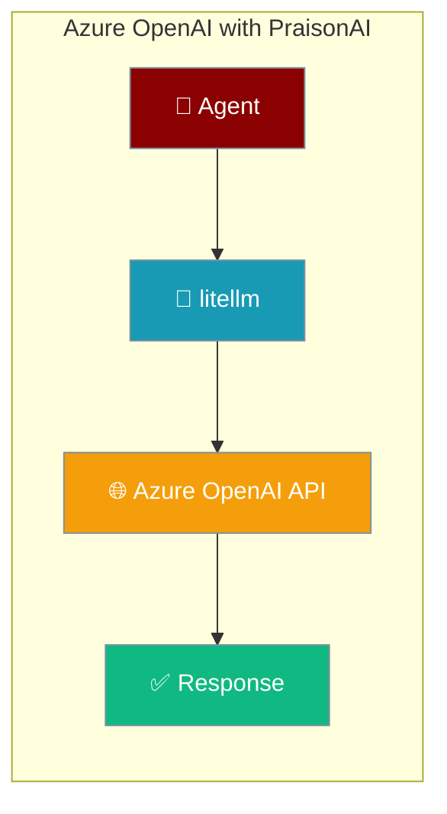
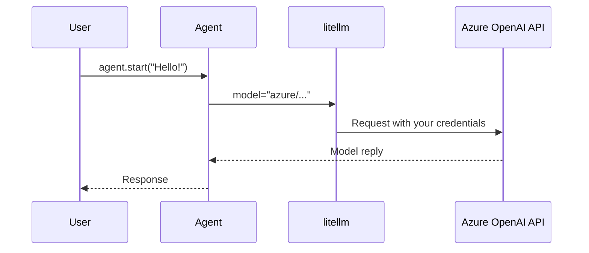

Point an Agent at Azure OpenAI by setting your credentials and naming the model.



## Quick Start

<Steps>
<Step title="Install">
```bash
pip install "praisonaiagents[llm]"
```
</Step>

<Step title="Set credentials">
```bash
export AZURE_API_KEY=your-azure-key
export AZURE_API_BASE=https://your-resource.openai.azure.com
export AZURE_API_VERSION=2024-02-15-preview
```
</Step>

<Step title="Run an agent">
```python
from praisonaiagents import Agent

agent = Agent(
    instructions="You are a helpful assistant",
    model="azure/gpt-4",
)

agent.start("Hello!")
```
</Step>
</Steps>

<Note>
The part after `azure/` is your **deployment name** in Azure, not the OpenAI model name. If your deployment is called `my-gpt4`, use `model="azure/my-gpt4"`.
</Note>

## How it works

The `azure/` prefix tells PraisonAI to route the request through litellm to Azure OpenAI, which reads `AZURE_API_KEY`, `AZURE_API_BASE`, `AZURE_API_VERSION` from your environment. See [Provider Auto-Detection](/models#provider-auto-detection-no-config-first-run) for how model strings are resolved.



## Common Patterns

### Pick a different model

Keep the `azure/` prefix and swap the rest for any model your Azure OpenAI account offers.

```python
from praisonaiagents import Agent

agent = Agent(
    instructions="You are a helpful assistant",
    model="azure/gpt-4",
)
```

### Tune the response with a config dict

Pass a dict to set temperature, token limits, or other options.

```python
from praisonaiagents import Agent

agent = Agent(
    instructions="You write short, friendly answers",
    model={
        "model": "azure/gpt-4",
        "temperature": 0.3,
        "max_tokens": 500,
    },
)

agent.start("Give me three tips for better sleep.")
```

## Best Practices

<AccordionGroup>
<Accordion title="Prefer the shortest form">
Start with `model="azure/gpt-4"` and nothing else. Add a config dict only when you need to tune temperature or limits.
</Accordion>

<Accordion title="Set the provider key once via env">
Export `AZURE_API_KEY`, `AZURE_API_BASE`, `AZURE_API_VERSION` in your shell or `.env` file. Keep keys out of your code.
</Accordion>

<Accordion title="Keep model= canonical">
Always use `model=`. The older `llm=` name still works but prints a deprecation warning. See [Model Parameter](/features/model-parameter).
</Accordion>
</AccordionGroup>

## Related

<CardGroup cols={2}>
<Card title="Models" icon="layers" href="/models">
All supported providers and how model strings resolve
</Card>
<Card title="Model Parameter" icon="cube" href="/features/model-parameter">
Why `model=` is the canonical name
</Card>
</CardGroup>
