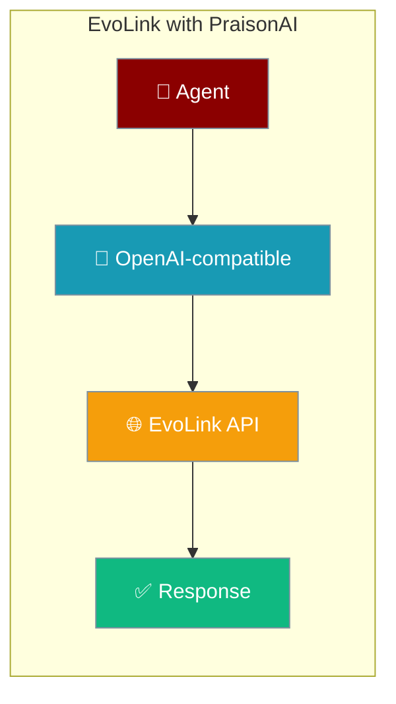
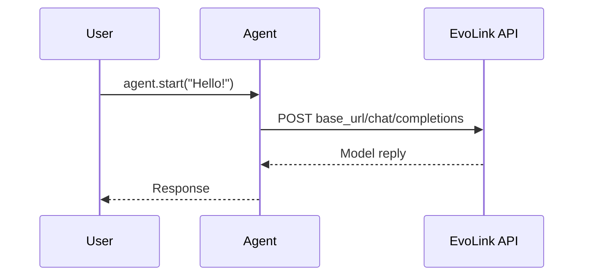

Point an Agent at EvoLink by passing its OpenAI-compatible endpoint and your key.



## Quick Start

<Steps>
<Step title="Install">
```bash
pip install "praisonaiagents[llm]"
```
</Step>

<Step title="Set credentials">
```bash
export EVOLINK_API_KEY=your-evolink-key
```
</Step>

<Step title="Run an agent">
```python
import os
from praisonaiagents import Agent

agent = Agent(
    instructions="You are a helpful assistant",
    model={
        "model": "openai/gpt-5.2",
        "api_key": os.getenv("EVOLINK_API_KEY"),
        "base_url": "https://direct.evolink.ai/v1",
    },
)

agent.start("Hello! Share one practical AI automation idea.")
```
</Step>
</Steps>

## How it works

EvoLink speaks the OpenAI API, so the agent sends requests to `base_url` with your key instead of using a `provider/` prefix. See [OpenAI-Compatible Endpoints](/models/openai-compatible) for the general pattern.



## Common Patterns

### Pick a different model

Change the `"model"` value to any model EvoLink offers. Keep `base_url` the same.

```python
import os
from praisonaiagents import Agent

agent = Agent(
    instructions="You are a helpful assistant",
    model={
        "model": "openai/gpt-5.2",
        "api_key": os.getenv("EVOLINK_API_KEY"),
        "base_url": "https://direct.evolink.ai/v1",
    },
)
```

### Tune the response

Add temperature or token limits to the same dict.

```python
import os
from praisonaiagents import Agent

agent = Agent(
    instructions="You write short, friendly answers",
    model={
        "model": "openai/gpt-5.2",
        "api_key": os.getenv("EVOLINK_API_KEY"),
        "base_url": "https://direct.evolink.ai/v1",
        "temperature": 0.3,
        "max_tokens": 500,
    },
)

agent.start("Write a Python function that checks if a string is a palindrome.")
```

## Best Practices

<AccordionGroup>
<Accordion title="Prefer the shortest form">
Only `model`, `api_key`, and `base_url` are needed. Add other options when you need them.
</Accordion>

<Accordion title="Set the provider key once via env">
Export `EVOLINK_API_KEY` in your shell or `.env` file and read it with `os.getenv`. Keep keys out of your code.
</Accordion>

<Accordion title="Keep model= canonical">
Always use `model=`. The older `llm=` name still works but prints a deprecation warning. See [Model Parameter](/features/model-parameter).
</Accordion>
</AccordionGroup>

## Related

<CardGroup cols={2}>
<Card title="Models" icon="layers" href="/models">
All supported providers and how model strings resolve
</Card>
<Card title="OpenAI-Compatible" icon="plug" href="/models/openai-compatible">
Connect any OpenAI-compatible endpoint
</Card>
</CardGroup>
