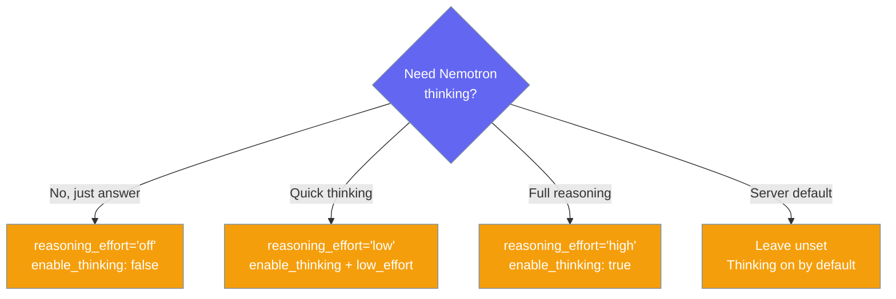

Use NVIDIA Nemotron 3 and other NIM-hosted models with a single environment variable.


## Quick Start

<Steps>
<Step title="Simplest usage">

```python
# export NVIDIA_API_KEY=nvapi-...
from praisonaiagents import Agent

agent = Agent(
    instructions="You are a helpful assistant",
    llm="nvidia/nemotron-super"
)
agent.start("Explain quantum computing in one sentence")
```

</Step>
<Step title="With a tool">

```python
# export NVIDIA_API_KEY=nvapi-...
from praisonaiagents import Agent

def get_weather(city: str) -> str:
    """Get the current weather for a city."""
    return f"Sunny in {city}"

agent = Agent(
    instructions="You are a weather assistant",
    llm="nvidia/nemotron-super",
    tools=[get_weather]
)
agent.start("What's the weather in Tokyo?")
```

</Step>
</Steps>

---

## Models

Short aliases map to the catalog slugs verified against `GET /v1/models` on 2026-10-15.

| You write | Sent on the wire | Notes |
|---|---|---|
| `nvidia/nemotron-super` | `nvidia/nemotron-3-super-120b-a12b` | Flagship, best quality |
| `nvidia/nemotron-nano` | `nvidia/nemotron-nano-3-30b-a3b` | Fast, small |
| `nvidia/nemotron-ultra` | `nvidia/nemotron-3-ultra-550b-a55b` | Largest |
| `nvidia/nemotron-3-super-120b-a12b` | same | Full slug also works |
| `nvidia/meta/llama-3.3-70b-instruct` | `meta/llama-3.3-70b-instruct` | Any NIM publisher |
| `nvidia_nim/nvidia/nemotron-3-super-120b-a12b` | same | Legacy prefix, still works |

---

## Environment Variables

Set one key for hosted NIM, and optionally override the key or endpoint.

```bash
# Hosted (build.nvidia.com)
export NVIDIA_API_KEY=nvapi-...

# Optional overrides
export NVIDIA_NIM_API_KEY=nvapi-...                   # takes precedence over NVIDIA_API_KEY
export NVIDIA_NIM_API_BASE=http://localhost:8000/v1   # or any OpenAI-compatible NIM endpoint
```

**Key order:** explicit `api_key=` → `NVIDIA_NIM_API_KEY` → `NVIDIA_API_KEY`. `OPENAI_API_KEY` is **never** used for NIM.

**Base-URL order:** explicit `base_url=` → `NVIDIA_NIM_API_BASE` → `https://integrate.api.nvidia.com/v1`.

<Warning>
If `NVIDIA_API_KEY` is unset and no `base_url` is given, hosted calls raise `ValueError`. Get a key at [build.nvidia.com](https://build.nvidia.com), or pass `base_url=` for a local NIM.
</Warning>

<Note>
Your `base_url` must end in `/v1`. Without it, requests go to `/chat/completions` and NIM returns 404.
</Note>

---

## Reasoning Mode

Nemotron 3 thinks by default, and `reasoning_effort` switches it on or off.

```python
# export NVIDIA_API_KEY=nvapi-...
from praisonaiagents import Agent

agent = Agent(
    instructions="Be brief",
    llm="nvidia/nemotron-super",
    reasoning_effort="off"   # or "minimal" | "low" | "medium" | "high"
)
agent.start("What is 2+2?")
```

| `reasoning_effort` | Sent to NIM |
|---|---|
| `"off"` | `chat_template_kwargs: { enable_thinking: False }` |
| `"minimal"` or `"low"` | `chat_template_kwargs: { enable_thinking: True, low_effort: True }` |
| `"medium"` or `"high"` | `chat_template_kwargs: { enable_thinking: True }` |
| unset / `None` | nothing (server default: thinking on) |

This mapping only applies to Nemotron 3 (and `nemotron-nano-3`) via the NIM route. Nemotron served by other providers and non-Nemotron NIM models use the standard `reasoning_effort` path.



---

## Override chat_template_kwargs

Your own `chat_template_kwargs` always wins over the `reasoning_effort` translation.

```python
from praisonaiagents import Agent

agent = Agent(
    instructions="Be brief",
    llm={
        "model": "nvidia/nemotron-super",
        "extra_body": {
            "chat_template_kwargs": {
                "enable_thinking": True,
                "low_effort": True,
                # any other template kwarg NIM supports
            }
        }
    }
)
```

When you set `chat_template_kwargs` yourself, `reasoning_effort` is not translated.

---

## Local NIM Container

Point `base_url` at your container and skip the key.

```python
# No NVIDIA_API_KEY needed when running against a local NIM container
from praisonaiagents import Agent

agent = Agent(
    instructions="Be brief",
    llm="nvidia/nemotron-super",
    base_url="http://localhost:8000/v1"
)
agent.start("Hello")
```

```bash
docker run --rm --gpus all \
  -e NIM_PASSTHROUGH_ARGS="--enable-auto-tool-choice --tool-call-parser qwen3_coder --reasoning-parser nemotron_v3" \
  -p 8000:8000 \
  nvcr.io/nim/nvidia/nemotron-3-super-120b-a12b:latest
```

The passthrough flags are only needed if you want tool calling and reasoning in the container. Without them, basic chat still works.

---

## Streaming

Stream tokens as they arrive.

```python
# export NVIDIA_API_KEY=nvapi-...
from praisonaiagents import Agent

agent = Agent(
    instructions="Tell a story",
    llm="nvidia/nemotron-super",
    stream=True
)

for chunk in agent.start("Tell me a one-paragraph story"):
    print(chunk, end="", flush=True)
```

Streaming works with and without tools.

---

## YAML

Set the model by name, with optional reasoning control.

```yaml
framework: praisonai
topic: Research NVIDIA Nemotron
agents:
  researcher:
    role: AI Researcher
    goal: Explain the Nemotron 3 family
    instructions: You are an expert on NVIDIA LLMs
    llm:
      model: nvidia/nemotron-super
      reasoning_effort: "off"
    tasks:
      research_task:
        description: Summarise the Nemotron 3 lineup in three bullets
        expected_output: Three bullet points
```

String form:

```yaml
framework: praisonai
topic: Quick answer
agents:
  assistant:
    role: Assistant
    goal: Answer briefly
    instructions: Be concise
    llm: nvidia/nemotron-super
```

---

## CLI

Pass the model with `--llm`.

```bash
export NVIDIA_API_KEY=nvapi-...  # or NVIDIA_NIM_API_KEY

# Basic prompt
python -m praisonai "Explain AI" --llm nvidia/nemotron-super

# Smaller, faster model
python -m praisonai "Quick answer" --llm nvidia/nemotron-nano
```

---

## Sampling

NVIDIA recommends `temperature=1.0` and `top_p=0.95` for Nemotron 3; these are not PraisonAI defaults.

```python
from praisonaiagents import Agent

agent = Agent(
    instructions="You are a helpful assistant",
    llm={
        "model": "nvidia/nemotron-super",
        "temperature": 1.0,
        "top_p": 0.95,
    }
)
```

---

## Common Pitfalls

<AccordionGroup>
<Accordion title="My OpenAI key is being used">
Not any more. As of PraisonAI PR #5832, `OPENAI_API_KEY` is never read for `nvidia/` or `nvidia_nim/` models. Set `NVIDIA_API_KEY` instead.
</Accordion>
<Accordion title="Local NIM returns 404">
Your `base_url` must end in `/v1`. Use `http://localhost:8000/v1`, not `http://localhost:8000`.
</Accordion>
<Accordion title="Tool calls don't trigger">
Hosted NIM works with the defaults. For a local NIM container, start it with `NIM_PASSTHROUGH_ARGS="--enable-auto-tool-choice --tool-call-parser qwen3_coder --reasoning-parser nemotron_v3"`.
</Accordion>
</AccordionGroup>

---

## Related

<CardGroup cols={2}>
  <Card title="OpenAI-Compatible Providers" icon="plug" href="/models/openai-compatible">
    Use any OpenAI-compatible endpoint
  </Card>
  <Card title="TypeScript NVIDIA NIM" icon="code" href="/js/providers/nvidia-nim-code">
    JS SDK equivalent
  </Card>
</CardGroup>
