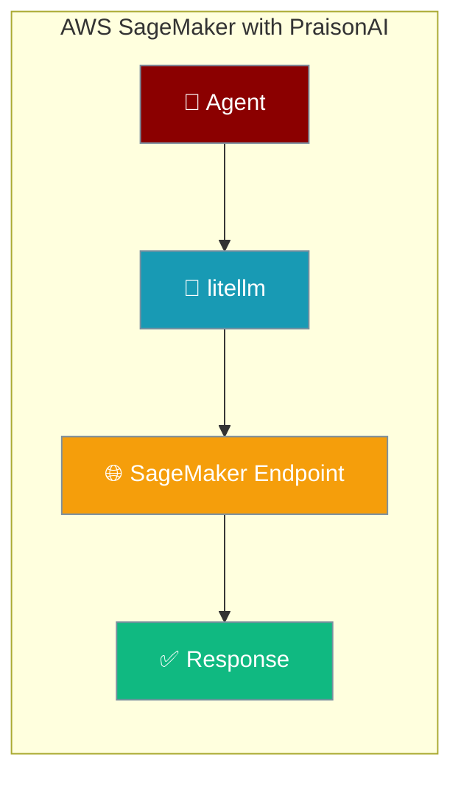
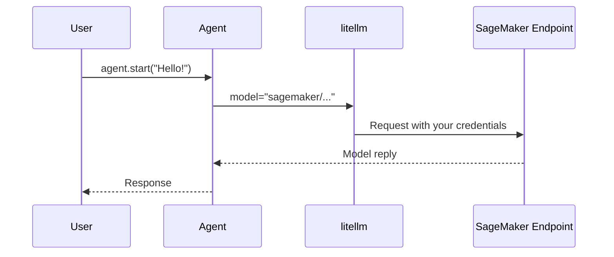

Point an Agent at AWS SageMaker by setting your credentials and naming the model.



## Quick Start

<Steps>
<Step title="Install">
```bash
pip install "praisonaiagents[llm]"
```
</Step>

<Step title="Set credentials">
```bash
export AWS_ACCESS_KEY_ID=your-access-key
export AWS_SECRET_ACCESS_KEY=your-secret-key
export AWS_REGION_NAME=us-east-1
```
</Step>

<Step title="Run an agent">
```python
from praisonaiagents import Agent

agent = Agent(
    instructions="You are a helpful assistant",
    model="sagemaker/meta-llama/Llama-3.1-8B-Instruct",
)

agent.start("Hello!")
```
</Step>
</Steps>

<Note>
SageMaker runs models on endpoints you deploy yourself. The part after `sagemaker/` is your endpoint name. For fully managed models on AWS, use [AWS Bedrock](/models/aws) instead.
</Note>

## How it works

The `sagemaker/` prefix tells PraisonAI to route the request through litellm to AWS SageMaker, which reads `AWS_ACCESS_KEY_ID`, `AWS_SECRET_ACCESS_KEY`, `AWS_REGION_NAME` from your environment. See [Provider Auto-Detection](/models#provider-auto-detection-no-config-first-run) for how model strings are resolved.



## Common Patterns

### Pick a different model

Keep the `sagemaker/` prefix and swap the rest for any model your AWS SageMaker account offers.

```python
from praisonaiagents import Agent

agent = Agent(
    instructions="You are a helpful assistant",
    model="sagemaker/<your-endpoint-name>",
)
```

### Tune the response with a config dict

Pass a dict to set temperature, token limits, or other options.

```python
from praisonaiagents import Agent

agent = Agent(
    instructions="You write short, friendly answers",
    model={
        "model": "sagemaker/meta-llama/Llama-3.1-8B-Instruct",
        "temperature": 0.3,
        "max_tokens": 500,
    },
)

agent.start("Give me three tips for better sleep.")
```

## Best Practices

<AccordionGroup>
<Accordion title="Prefer the shortest form">
Start with `model="sagemaker/meta-llama/Llama-3.1-8B-Instruct"` and nothing else. Add a config dict only when you need to tune temperature or limits.
</Accordion>

<Accordion title="Set the provider key once via env">
Export `AWS_ACCESS_KEY_ID`, `AWS_SECRET_ACCESS_KEY`, `AWS_REGION_NAME` in your shell or `.env` file. Keep keys out of your code.
</Accordion>

<Accordion title="Keep model= canonical">
Always use `model=`. The older `llm=` name still works but prints a deprecation warning. See [Model Parameter](/features/model-parameter).
</Accordion>
</AccordionGroup>

## Related

<CardGroup cols={2}>
<Card title="Models" icon="layers" href="/models">
All supported providers and how model strings resolve
</Card>
<Card title="Model Parameter" icon="cube" href="/features/model-parameter">
Why `model=` is the canonical name
</Card>
</CardGroup>
