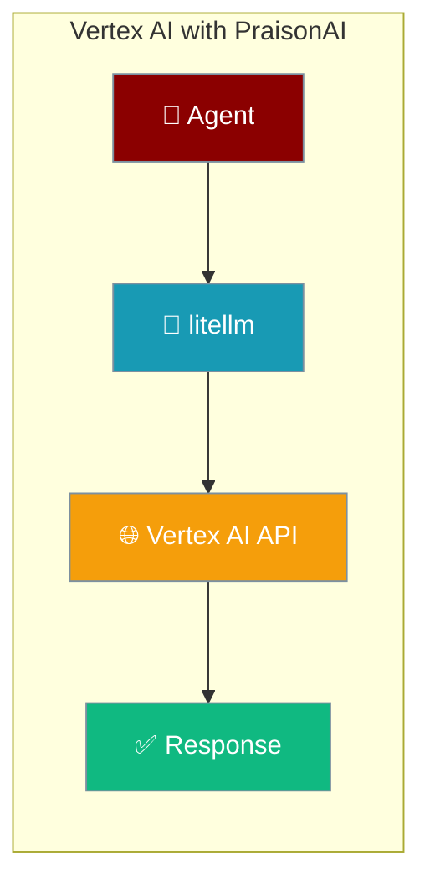
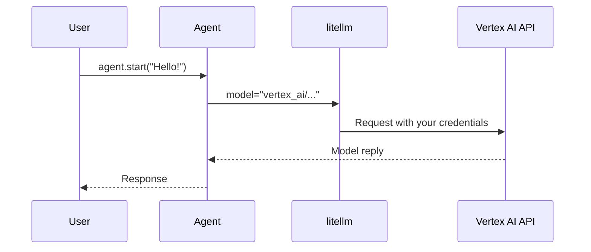

Point an Agent at Vertex AI by setting your credentials and naming the model.



## Quick Start

<Steps>
<Step title="Install">
```bash
pip install "praisonaiagents[llm]"
```
</Step>

<Step title="Set credentials">
```bash
export VERTEXAI_PROJECT=your-gcp-project
export VERTEXAI_LOCATION=us-central1
```
</Step>

<Step title="Run an agent">
```python
from praisonaiagents import Agent

agent = Agent(
    instructions="You are a helpful assistant",
    model="vertex_ai/gemini-1.5-pro",
)

agent.start("Hello!")
```
</Step>
</Steps>

<Note>
Vertex AI uses Google Cloud credentials. Run `gcloud auth application-default login` once before starting your agent. Claude models on Vertex (`vertex_ai/claude-...`) are detected as Anthropic — see [Routed model provider detection](/models#routed-model-provider-detection).
</Note>

## How it works

The `vertex_ai/` prefix tells PraisonAI to route the request through litellm to Vertex AI, which reads `VERTEXAI_PROJECT`, `VERTEXAI_LOCATION` from your environment. See [Provider Auto-Detection](/models#provider-auto-detection-no-config-first-run) for how model strings are resolved.



## Common Patterns

### Pick a different model

Keep the `vertex_ai/` prefix and swap the rest for any model your Vertex AI account offers.

```python
from praisonaiagents import Agent

agent = Agent(
    instructions="You are a helpful assistant",
    model="vertex_ai/gemini-1.5-pro",
)
```

### Tune the response with a config dict

Pass a dict to set temperature, token limits, or other options.

```python
from praisonaiagents import Agent

agent = Agent(
    instructions="You write short, friendly answers",
    model={
        "model": "vertex_ai/gemini-1.5-pro",
        "temperature": 0.3,
        "max_tokens": 500,
    },
)

agent.start("Give me three tips for better sleep.")
```

### Use Claude on Vertex AI

Claude models hosted on Vertex AI use the same `vertex_ai/` prefix.

```python
from praisonaiagents import Agent

agent = Agent(
    instructions="You are a helpful assistant",
    model="vertex_ai/claude-3-5-sonnet@20240620",
)

agent.start("Hello!")
```

## Best Practices

<AccordionGroup>
<Accordion title="Prefer the shortest form">
Start with `model="vertex_ai/gemini-1.5-pro"` and nothing else. Add a config dict only when you need to tune temperature or limits.
</Accordion>

<Accordion title="Set the provider key once via env">
Export `VERTEXAI_PROJECT`, `VERTEXAI_LOCATION` in your shell or `.env` file. Keep keys out of your code.
</Accordion>

<Accordion title="Keep model= canonical">
Always use `model=`. The older `llm=` name still works but prints a deprecation warning. See [Model Parameter](/features/model-parameter).
</Accordion>
</AccordionGroup>

## Related

<CardGroup cols={2}>
<Card title="Models" icon="layers" href="/models">
All supported providers and how model strings resolve
</Card>
<Card title="Model Parameter" icon="cube" href="/features/model-parameter">
Why `model=` is the canonical name
</Card>
</CardGroup>
