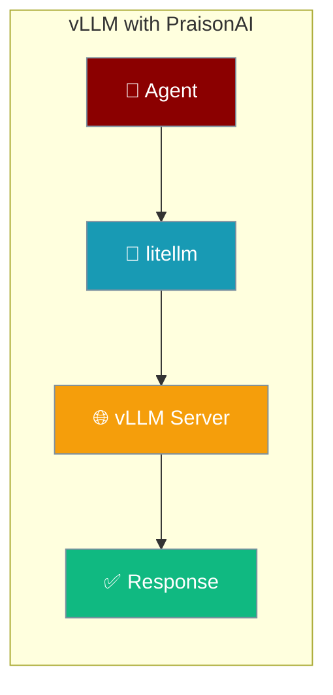
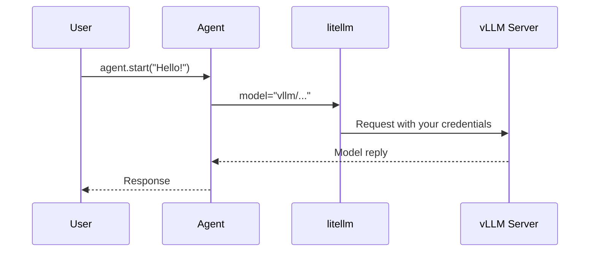

Point an Agent at vLLM by setting your credentials and naming the model.



## Quick Start

<Steps>
<Step title="Install">
```bash
pip install "praisonaiagents[llm]"
```
</Step>

<Step title="Set credentials">
```bash
export VLLM_API_BASE=http://localhost:8000/v1
```
</Step>

<Step title="Run an agent">
```python
from praisonaiagents import Agent

agent = Agent(
    instructions="You are a helpful assistant",
    model="vllm/meta-llama/Llama-3.1-8B-Instruct",
)

agent.start("Hello!")
```
</Step>
</Steps>

<Note>
vLLM is self-hosted — start your vLLM server first, then point the agent at it.
</Note>

## How it works

The `vllm/` prefix tells PraisonAI to route the request through litellm to vLLM, which reads `VLLM_API_BASE` from your environment. See [Provider Auto-Detection](/models#provider-auto-detection-no-config-first-run) for how model strings are resolved.



## Common Patterns

### Pick a different model

Keep the `vllm/` prefix and swap the rest for any model your vLLM account offers.

```python
from praisonaiagents import Agent

agent = Agent(
    instructions="You are a helpful assistant",
    model="vllm/meta-llama/Llama-3.1-8B-Instruct",
)
```

### Tune the response with a config dict

Pass a dict to set temperature, token limits, or other options.

```python
from praisonaiagents import Agent

agent = Agent(
    instructions="You write short, friendly answers",
    model={
        "model": "vllm/meta-llama/Llama-3.1-8B-Instruct",
        "temperature": 0.3,
        "max_tokens": 500,
    },
)

agent.start("Give me three tips for better sleep.")
```

### Point at your own server

Set `base_url` to reach a vLLM server on another host or port.

```python
from praisonaiagents import Agent

agent = Agent(
    instructions="You are a helpful assistant",
    model={
        "model": "vllm/meta-llama/Llama-3.1-8B-Instruct",
        "base_url": "http://my-gpu-box:8000/v1",
    },
)

agent.start("Hello!")
```

### Let the agent find your server

`model="local:vllm"` discovers a running vLLM server and picks its model for you — no URL, no model name.

```python
from praisonaiagents import Agent

agent = Agent(instructions="You are a helpful assistant", model="local:vllm")
agent.start("Hello!")
```

See [Local Model Resolver](/features/local-model-resolver) for details.

## Best Practices

<AccordionGroup>
<Accordion title="Prefer the shortest form">
Start with `model="vllm/meta-llama/Llama-3.1-8B-Instruct"` and nothing else. Add a config dict only when you need to tune temperature or limits.
</Accordion>

<Accordion title="Set the provider key once via env">
Export `VLLM_API_BASE` in your shell or `.env` file. Keep keys out of your code.
</Accordion>

<Accordion title="Use model=&quot;local:vllm&quot; for auto-discovery">
On your own machine, `model="local:vllm"` finds the running server for you, so you never hard-code a URL.
</Accordion>

<Accordion title="Keep model= canonical">
Always use `model=`. The older `llm=` name still works but prints a deprecation warning. See [Model Parameter](/features/model-parameter).
</Accordion>
</AccordionGroup>

## Related

<CardGroup cols={2}>
<Card title="Models" icon="layers" href="/models">
All supported providers and how model strings resolve
</Card>
<Card title="Model Parameter" icon="cube" href="/features/model-parameter">
Why `model=` is the canonical name
</Card>
</CardGroup>
