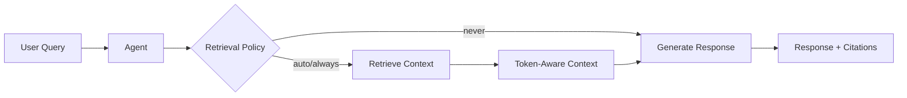
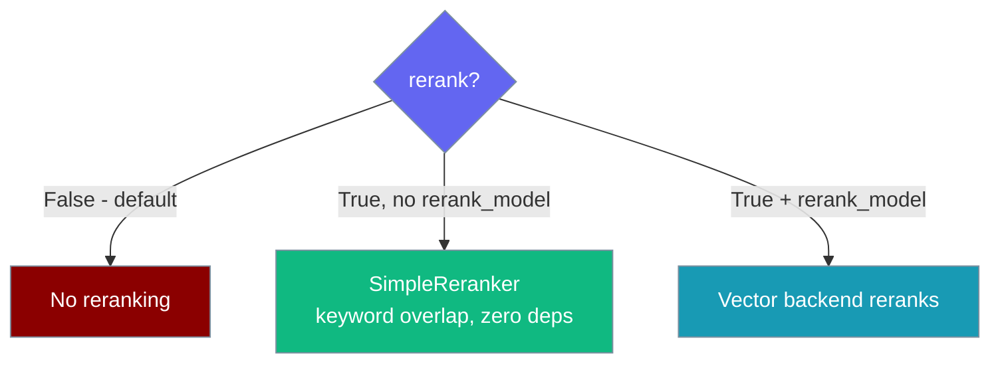

## Overview

The Agent-first retrieval system provides a unified way to configure how agents retrieve and use knowledge. All retrieval behavior is controlled through the `knowledge` parameter.



## Quick Start

```python
from praisonaiagents import Agent

agent = Agent(
    name="Research Agent",
    instructions="Answer questions based on the provided documents.",
    knowledge={
        "sources": ["docs/", "papers.pdf"],
        "retrieval_k": 5,        # Number of chunks to retrieve
        "rerank": True,          # Enable reranking for better results
    }
)

# Chat with automatic retrieval
response = agent.chat("What are the key findings?")
print(response)
```

<Note>
Want Gemini, Cohere, or a local Ollama model instead of OpenAI? See [Knowledge → Use a non-OpenAI embedder](/features/knowledge#use-a-non-openai-embedder).
</Note>

## Knowledge Configuration

### Full Configuration Options

```python
from praisonaiagents import Agent, KnowledgeConfig

agent = Agent(
    name="Agent",
    instructions="You are a helpful assistant.",
    knowledge=KnowledgeConfig(
        # Knowledge sources
        sources=["documents/"],
        
        # Embedder configuration ("openai" is the default and means "no override").
        # Use a different provider — see /features/knowledge#use-a-non-openai-embedder
        embedder="openai",
        embedder_config={"model": "text-embedding-3-small"},
        
        # Chunking strategy
        chunking_strategy="semantic",
        chunk_size=1000,
        chunk_overlap=200,
        
        # Retrieval parameters
        retrieval_k=5,                    # Number of chunks to retrieve
        retrieval_threshold=0.0,          # Minimum relevance score (0.0-1.0)
        
        # Reranking
        rerank=False,                     # Enable reranking for better relevance
        rerank_model=None,                # Custom rerank model
        
        # Auto-retrieval
        auto_retrieve=True,               # Automatically inject context
        
        # Vector store
        vector_store={"provider": "chroma", "collection_name": "default"},
    )
)
```

### Using Dict Configuration

```python
from praisonaiagents import Agent

# Simple configuration with dict
agent = Agent(
    name="Agent",
    knowledge={
        "sources": ["docs/"],
        "retrieval_k": 5,
        "retrieval_threshold": 0.3,
        "rerank": True,
    }
)
```

## Agent Methods

### `agent.chat()` - Conversational Interface

The default method for conversation with automatic retrieval.

```python
# Normal chat (uses auto-retrieval)
response = agent.chat("What is the main topic?")

# Force retrieval
response = agent.chat("Hello", force_retrieval=True)

# Skip retrieval
response = agent.chat("What is 2+2?", skip_retrieval=True)
```

### `agent.query()` - Structured Answer with Citations

Returns a structured result with answer, citations, and metadata.

```python
from praisonaiagents import Agent

agent = Agent(
    name="Research Agent",
    knowledge={
        "sources": ["research_paper.pdf"],
        "retrieval_k": 5,
    }
)

result = agent.query("What are the main findings?")

print(f"Answer: {result.answer}")
print(f"Context used: {len(result.context_used)} chars")

for citation in result.citations:
    print(f"  [{citation.id}] {citation.source}")
    print(f"      Score: {citation.score:.2f}")
    print(f"      Text: {citation.text[:100]}...")
```

### `agent.retrieve()` - Retrieval Only (No LLM)

Returns context without LLM generation. Useful for conditional retrieval workflows.

```python
# Retrieve context only
context_pack = agent.retrieve("What are the key points?")

print(f"Found {len(context_pack.citations)} sources")
print(f"Context: {context_pack.context[:500]}...")

# Use context in a custom workflow
if context_pack.citations:
    response = agent.chat(
        f"Based on this context, summarize: {context_pack.context}"
    )

# Note: Each retrieved item is a SearchResultItem object (see praisonaiagents.knowledge.models)
# that can be passed directly into build_context / deduplicate_chunks
```

## Multi-Agent with Shared Knowledge

Multiple agents can share the same knowledge base:

```python
from praisonaiagents import Agent
from praisonaiagents import Knowledge

# Create shared knowledge instance
shared_knowledge = Knowledge(config={
    "vector_store": {
        "provider": "chroma",
        "config": {"collection_name": "shared_docs"}
    }
})

# Index documents once
shared_knowledge.add("company_docs/")

# Multiple agents share the same knowledge
analyst = Agent(
    name="Analyst",
    instructions="Analyze data from documents.",
    knowledge={
        "sources": shared_knowledge,
        "retrieval_k": 10,
    }
)

summarizer = Agent(
    name="Summarizer", 
    instructions="Summarize key points.",
    knowledge={
        "sources": shared_knowledge,
        "retrieval_k": 5,
    }
)

# Both agents use the same indexed knowledge
analysis = analyst.chat("What trends do you see?")
summary = summarizer.chat("Summarize the main points")
```

## Reranking

Reranking reorders retrieved chunks by relevance to the query before the LLM sees them. Turn it on in one line:

```python
from praisonaiagents import Agent

agent = Agent(
    name="Researcher",
    instructions="Answer from the knowledge base.",
    knowledge=["docs/*.pdf"],
    retrieval_config={"rerank": True},  # zero-dependency keyword reranker
)
agent.start("What does the on-call runbook say about rolling back a deploy?")
```

Since PraisonAI PR [#6060](https://github.com/MervinPraison/PraisonAI/pull/6060), `rerank=True` is wired through the agent's RAG pipeline — earlier releases accepted it without reranking anything.



| Setting | What reranks |
|---------|--------------|
| `rerank=False` (default) | Nothing |
| `rerank=True` | Built-in `SimpleReranker` — keyword overlap, no extra install |
| `rerank=True, rerank_model="cohere/rerank-v3"` | The vector backend; the SDK does not add a second reranker |

**How to tell it ran:** `metadata["reranked"]` reports whether a reranker actually ran, not just whether it was requested.

```python
pack = agent.rag.retrieve("rollback steps")
print(pack.metadata["reranked"])  # True when a reranker ran
```

With a `rerank_model`, `reranked` is `True` only when the knowledge backend declares a reranker, e.g. mem0 configured with `{"reranker": {"default_rerank": True, "provider": ...}}`.

<Note>
`SimpleReranker` scores by keyword overlap — no embeddings. For semantic reranking, set a `rerank_model` on a backend that supports it. It reads dict hits (`"text"`), mem0-style hits (`"memory"`), and `SearchResultItem` objects.
</Note>

## Handling Retrieval Failures

A failed vector-store call returns empty `chunks` with `retrieval_failed=True` and an `error` message on the `RetrievalResult` — it does not raise. Check the flag before trusting an empty result so a broken store never looks like a genuine no-match. See [Detect Retrieval Failures](/features/smart-retrieval#detect-retrieval-failures) for the full pattern.

## Next Steps

- [CLI Retrieval Commands](/cli/retrieval) - Use retrieval from the command line
- [Knowledge Concepts](/concepts/knowledge) - Learn about knowledge bases
- [Memory](/concepts/memory) - Combine with agent memory
