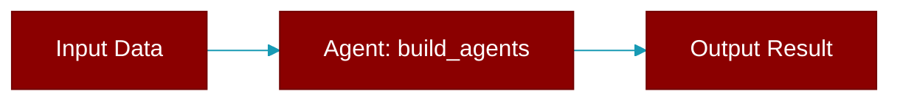

# build_agents

<div className="flex items-center gap-2">
  <Badge color="purple">Method</Badge>
</div>

> This is a method of the [**AgentsGenerator**](../classes/AgentsGenerator) class in the [**agents_generator**](../modules/agents_generator) module.

Build the agent objects from the YAML spec *without running them*.

This is the "build only" counterpart to
:meth:`generate_crew_and_kickoff` and exists for callers that need the
constructed :class:`~praisonaiagents.Agent` instances rather than a run
result -- e.g. the ``praisonai eval`` evaluators, which drive an agent
themselves. It reuses the same :meth:`_prepare_for_run` normalisation so
the agents are identical to what a real run would build.



## Signature

```python
def build_agents() -> Any
```

### Returns

<ResponseField name="Returns" type="Any">
  The constructed agent instances (empty list if none defined).
</ResponseField>


## Uses

- `callable`
- `NotImplementedError`
- `builder`


## Source

<Card title="View on GitHub" icon="github" href="https://github.com/MervinPraison/PraisonAI/blob/main/src/praisonai/praisonai/agents_generator.py#L1667">
  `praisonai/agents_generator.py` at line 1667
</Card>


---

## Related Documentation

<CardGroup cols={2}>
  <Card title="Agents Concept" icon="robot" href="/docs/concepts/agents" />
  <Card title="Single Agent Guide" icon="book-open" href="/docs/guides/single-agent" />
  <Card title="Multi-Agent Guide" icon="users" href="/docs/guides/multi-agent" />
  <Card title="Agent Configuration" icon="gear" href="/docs/configuration/agent-config" />
  <Card title="Auto Agents" icon="wand-magic-sparkles" href="/docs/features/autoagents" />
</CardGroup>
