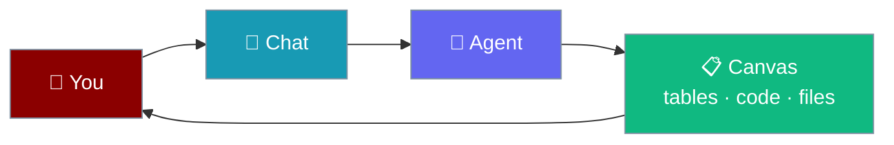
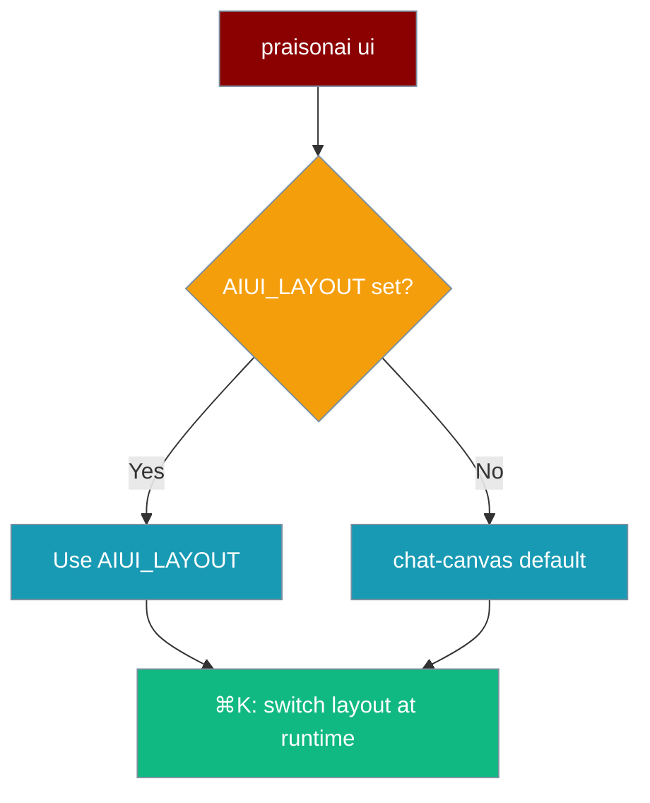

PraisonAI UI opens your agents in **Chat + Canvas**: the chat on the left, and the tables, code and files the agent writes on a canvas beside it. Powered by `praisonaiui`.



## Quick Start

<Steps>
<Step title="Install">

```bash
pip install "praisonai[ui]"
```
</Step>

<Step title="Launch">

```bash
praisonai ui            # chat          → http://localhost:8081
praisonai ui agents     # YAML agents   → http://localhost:8083
praisonai ui bot        # bot interface → http://localhost:8084
praisonai ui realtime   # realtime voice → http://localhost:8085
```

Each command opens in Chat + Canvas with the full 16-page `DASHBOARD_PAGES` sidebar (the same sidebar pages as `praisonai dashboard`), a welcome greeting in the new-chat hero (`aiui >= 0.3.170`), and the **Connect** MCP page (`aiui >= 0.3.172`).

<Note>
**Auto-refresh, virtualenv launch, and `SIGTERM` shutdown:** `praisonai ui` (and `ui agents`, `ui bot`, `ui realtime`) launches `aiui` via `sys.executable -m praisonaiui.cli run`, auto-refreshes untouched stamped copies of `~/.praisonai/<ui>/app.py` on upgrade while preserving user-edited files, and cleanly stops the child `aiui` server when it receives `SIGTERM`.
</Note>
</Step>
</Steps>

## Features

- **Chat + Canvas:** tables, code and files appear on a canvas beside the chat — sort, copy, download, compare versions.
- **Look:** light/dark via the top-bar toggle; ⌘K → **Switch look: Pro** swaps the Paper look for the plain one.
- **Stop:** the Stop button cancels the agent's reply. A reply idle for 10 minutes is cancelled too.
- **Uploads up to 25 MiB** (configurable).
- **Customizable:** Provide your own `app.py` or `agents.yaml` file to define custom agents or tasks.
- **Auto-Reload:** Supports developer-friendly dynamic reloading.
- **Host Integration:** Embed directly in your applications using Pattern B integration.

## Layout and Look

The bundled UIs open in `chat-canvas` with the **Paper** look (warm paper neutrals, serif titles). Each app keeps its own accent colour.



| Layout | What you see |
|---|---|
| `chat-canvas` | Chat with a canvas beside it (default) |
| `chat` | Chat only, no canvas |
| `workbench`, `command`, `guided`, `mission` | Alternative aiui layouts |

```bash
AIUI_LAYOUT=chat praisonai ui   # one run without the canvas
```

Switch layout or look at runtime from the command palette (⌘K). ⌘K → **Switch look: Pro** brings back the plain look.

## Stop & Timeouts

The Stop button cancels the agent's reply. A reply that sends nothing for 10 minutes is cancelled automatically.

```bash
AIUI_REPLY_IDLE_TIMEOUT=0 praisonai ui   # never time out idle replies
```

`AIUI_REPLY_IDLE_TIMEOUT` is in seconds (default `600`, `0` turns it off).

## Uploads & Limits

Request bodies are capped at 25 MiB.

```bash
AIUI_MAX_BODY_MB=100 praisonai ui   # allow 100 MiB uploads
```

`AIUI_MAX_BODY_MB` defaults to `25`; `0` turns the cap off.

## Data Directories

Set both variables to keep everything on a mounted volume (for example in Docker).

| Path | Contents | Move with |
|---|---|---|
| `~/.praisonai/sessions` | Chat history (PraisonAI-managed) | `PRAISONAI_HOME` |
| `~/.praisonaiui` | UI settings (aiui-managed) | `AIUI_DATA_DIR` |

See [aiui Environment Variables](/features/aiui-environment-variables) for every variable in one place.

## Run in Your Own Host

Integrate PraisonAI UI directly into your Python application:

```python
from praisonai.integration import build_host_app

# Create host app with UI integration
app = build_host_app(
    title="My Agent App",
    pages=["chat", "agents", "sessions"],
    agents=[{
        "name": "Assistant",
        "instructions": "You are a helpful assistant",
        "llm": "gpt-4o"
    }]
)

# Run with uvicorn, gunicorn, or any ASGI server
# uvicorn main:app --host 0.0.0.0 --port 8000
```

### Legacy Mode

`praisonai ui` now uses `configure_host()` internally with configurable `style` and `context_paths` options. For the old callback-only behavior:

```bash
export PRAISONAI_HOST_LEGACY=1
praisonai ui
```

This disables provider wiring and uses only `@aiui.reply` callbacks.

See [Host Integration](/features/host-integration) for complete integration patterns.

## External Agents

The PraisonAI UI automatically detects installed external CLI tools and shows checkboxes for available agents. When working with `AgentTeam` configurations, enabled external agents add tools that can be merged with YAML-defined role tools.

### Available Agent Toggles

When external CLIs are installed, the following checkboxes appear automatically:

- **Claude Code**: Enable for file editing and advanced coding tasks
- **Gemini CLI**: Enable for code analysis and search capabilities  
- **Codex CLI**: Enable for refactoring and optimization tasks
- **Cursor CLI**: Enable for IDE-integrated development workflows

### AgentTeam Integration

External agent tools merge seamlessly with `AgentTeam` member configurations:

```python
# YAML-defined agent with role tools
agent_config = {
    "role": "Senior Developer", 
    "tools": ["file_reader", "web_search"]  # From YAML
}

# External agents add additional tools when toggles are enabled:
# → ["file_reader", "web_search", "claude_tool", "gemini_tool"]
```

### Session-Based Settings

- **Persistence**: Session-based toggles reset on browser refresh
- **Auto-Detection**: Only available/installed CLIs show checkboxes
- **Workspace Context**: External agents operate within `PRAISONAI_WORKSPACE`

<Note>
For comprehensive documentation on external agents across all PraisonAI interfaces, see [External Agents in UI](/features/external-agents-ui).
</Note>

## CLI Options

You can customize how the UI starts using flags:

```bash
praisonai ui                        # Chat on port 8081
praisonai ui --port 9000            # Run on custom port 9000
praisonai ui --host 127.0.0.1      # Bind to localhost only
praisonai ui --app my-chat.py       # Load a custom Python config
praisonai ui --reload               # Enable auto-reload on file changes
```

## Custom Chat Applications

By default, the `praisonai ui` command provisions a default chat application located at `~/.praisonai/ui/app.py`. 

You can define your own custom chat experience using a standard Python script and pointing the `praisonai ui` command to it:

```bash
praisonai ui --app custom-agent.py
```

## Related

<CardGroup cols={2}>
<Card title="aiui Environment Variables" icon="sliders" href="/features/aiui-environment-variables">
  Configure layout, timeouts, upload limits and data directories.
</Card>
<Card title="PraisonAI Claw" icon="lobster" href="/ui/claw">
  Need channels and admin pages? Use PraisonAI Claw to manage channels, knowledge, and multi-agent memory.
</Card>
<Card title="PraisonAI Chat" icon="comments" href="/ui/chat">
  Want to dynamically chat with 100+ LLMs with vision capabilities? Explore PraisonAI Chat.
</Card>
</CardGroup>